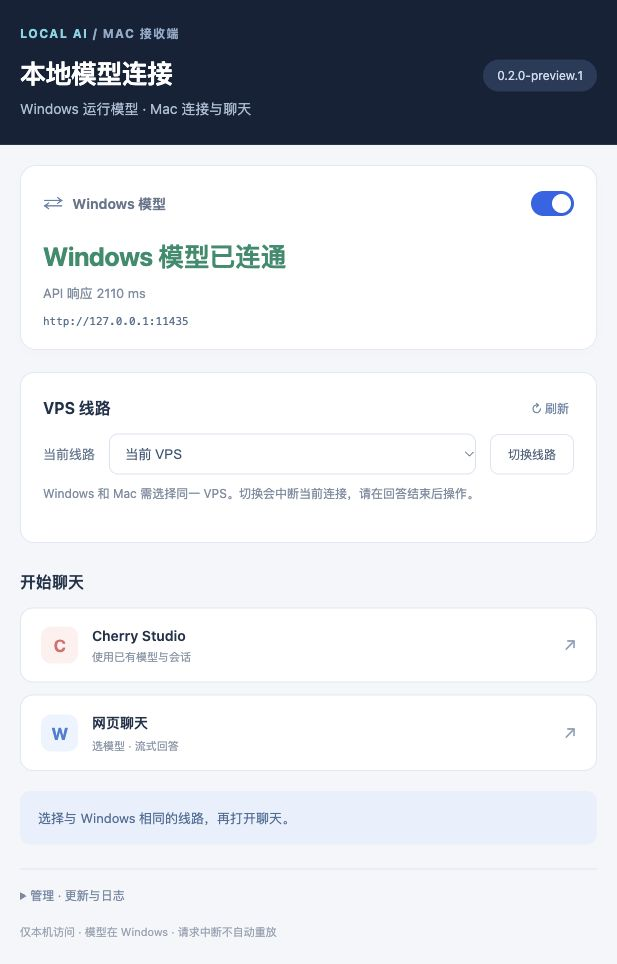
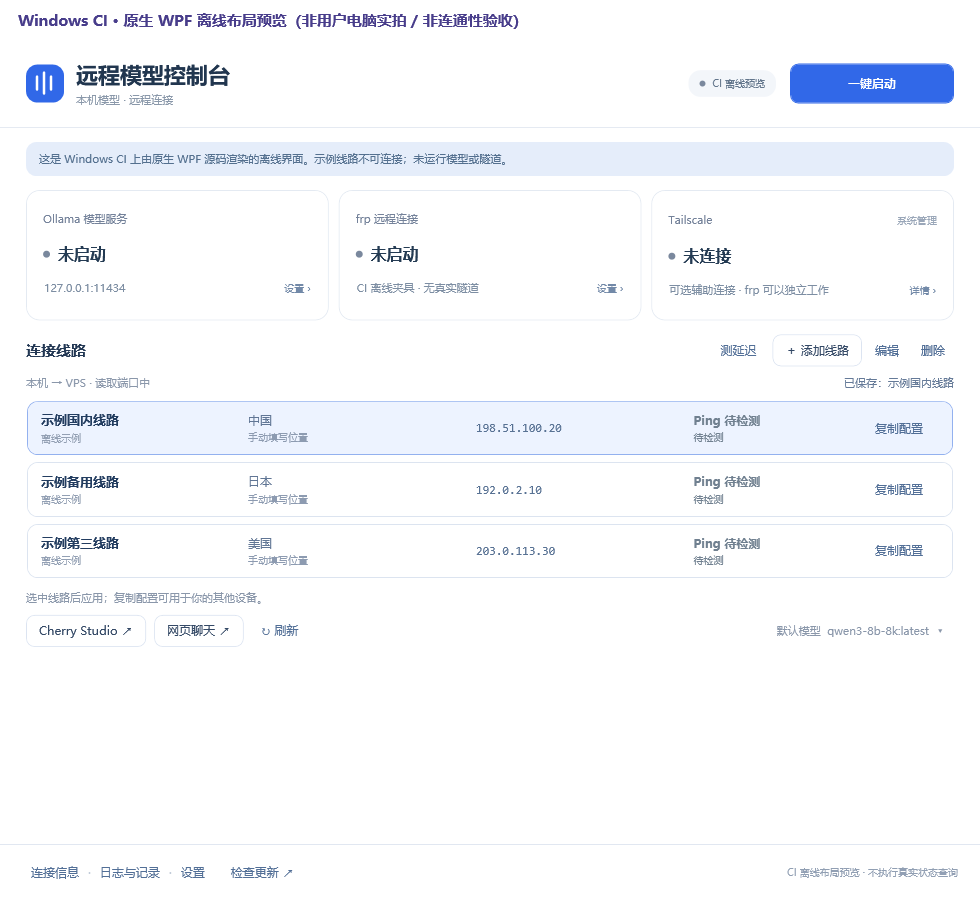

# 远程本地模型 · frpc

**Windows 运行模型，Mac 连接与聊天。** 两端共用一个仓库和版本渠道，实际节点配置与密钥各自保存在本机。

Mac 首页提供模型连接、VPS 线路、Cherry Studio 和网页聊天；配置过 Sub2API 时显示独立连接卡片及 CC Switch 入口。原生 Mac App 提供菜单栏运行图标、可复用的应用窗口、⌘W 关闭、⌘M 最小化与全部退出。更新与日志折叠到管理入口。Codex 供应商和认证由 CC Switch 管理。

Mac `0.2.0-preview.6` 将首页改为直观的节点列表：名称、地区、IP/端口、使用中/备用/待应用状态，逐行使用、编辑、检测和复制 IP。选中即可编辑原节点；新增可沿用现有配套参数，只改名称/IP，高级端口、provider 与凭据仍可编辑。地区按公网节点 IP 自动识别，无需手选；Ping 与 TCP 分别手动检测，不代表 Windows 模型 API 已连通。保留分层诊断、分类日志、网页模型偏好、菜单栏和原生双视图。

两张服务卡共用下方**一个 VPS 节点区、一个管理窗口**，支持新增、编辑、复制、删除和配套 visitor 导入。同一 IP/端口的旧配置合并显示；一次“使用”同时为 Ollama 与 Sub2API 应用 VPS，保留两条连接各自的原开关状态及 provider、认证和本机端口。保存不切线，不修改 CC Switch 或现有下游 Key。

| 组件 | 源码 | 当前范围 |
| --- | --- | --- |
| Mac 接收端 | [mac/console](mac/console) | 原生 Ollama API、流式网页聊天、复用已有网关管理器 |
| Windows 模型面板 | [windows/local-model-console](windows/local-model-console) | 原生 WPF 界面、模型/隧道状态、线路管理、日志；复用已有模型项目 |
| Windows Sub2API 扩展 | [windows/sub2api-local](windows/sub2api-local) | 独立 Docker/STCP 部署脚本，非本地模型推理服务 |
| 双端更新 | [tools](tools) | 稳定/预览查询、校验下载、源码选择与回退；不覆盖配置或重启模型 |

Sub2API 扩展已将 frpc 纳入同一 Docker 项目，整组启停；详见 [Windows 扩展](windows/sub2api-local/README.md)。

Windows 的模型面板、FRP 线路管理和 Sub2API 部署源码已统一收录；完整目录及私人数据边界见 [项目整理与交付](docs/项目整理与交付.md)。当前 Windows 面板为 1.1.2，包含一键启停、独立服务控制、线路名称、访客配置复制、模型选择和端口设置。





[统一使用与维护](docs/统一使用与维护.md) · [操作步骤](docs/操作步骤.md) · [双端维护与更新](docs/维护与更新.md) · [验收状态](docs/验收.md) · [GitHub 发布](https://github.com/dneo9527-ctrl/remote-local-model-frpc/releases)

后续 Windows 原面板的 Sub2API 卡片、独立节点档案与诊断整合任务见 [Windows 实施交接](docs/WINDOWS_PANEL_NEXT.md)。这是后续任务，当前 Windows 1.1.2 仍独立启动 Sub2API。

Sub2API 独立扩展的 Mac 现场结果与待办见 [Mac Sub2API 交接](docs/MAC_SUB2API_HANDOFF.md)。该连接与已验收的 Ollama 连接分别管理。

## 运行与连接

Python 3.11+，仅标准库。复用已有 Python/frpc；Mac 不安装 Ollama、模型权重或 Docker。完整源码解压后，将示例配置复制到**源码目录外**，填写本机已安装的路径：

```sh
python3 tools/launch.py --config /absolute/private/settings.json --state /absolute/private/updates
```

Windows 使用 `config.windows.example.json` 与 `tools/Launch-Windows.ps1`，选择同一已校验版本后，在源码外构建并打开原生 WPF 面板；配置和模型留在原项目。原生 EXE 自身无需 Python。两端更新都需关闭旧面板后重新打开，步骤见维护说明。

Mac 固定入口为 `http://127.0.0.1:11435`，OpenAI 兼容入口为 `http://127.0.0.1:11435/v1`，STCP visitor 为 `127.0.0.1:11436`。Windows Ollama 使用本机 `11434`；两端 STCP 必须连接同一 VPS、同一 provider 与配套密钥。校园网继续使用 frp，不全局切换 VPN。

连接切换只对新连接生效；不重放已经开始的生成请求。Windows 停机时本地模型不可用；Sub2API 是独立服务，不能拿它的在线状态代替 Windows 推理验证。

## 版本与发布

统一版本见 [version.json](version.json)。`windows` 保留来源端提交，`codex/mac-receiver` 是本次整合候选，审核后通过 PR 进入 `main`。稳定 tag 为 `vX.Y.Z`，预览为 `vX.Y.Z-preview.N`。源码分支变化不等于已发布新版；以 Releases 的准确 tag、附件与校验结果为准。

当前是源码预览：无打包 Python/frpc、无 Apple 公证。Windows 原生构建/隔离检查与真实 Windows 机器部署分别验收；双端多 VPS 实机切换、Codex GUI 新聊天等只在对应验收通过后才标完成。Mac 控制台与新增更新代码各有 MIT 许可；Windows Sub2API 的第三方许可见其 THIRD-PARTY。国旗资源已与 FlagCDN 原文件逐一核对，其提供方声明为 public domain；Windows 模型 GUI 的自有源码与脚本使用其目录内的 MIT 许可。许可按组件分别保留，见 [许可范围](LICENSES.md)。
