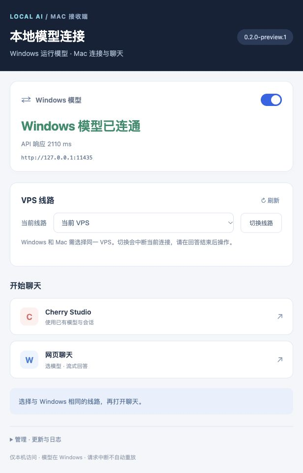

# 整合预览验收

## 0.2.0-preview.5（2026-11-19）

本版包含 Mac 分层手动诊断、五分钟健康时效、线路待应用与生成保护、多 VPS 线路管理/导入/复制、分类事件日志、网页模型偏好及原生双视图状态保留。Windows 来源为 `75c4435b2736037cfecad9d80223071e1eb06817`，其原有组件被整合，未在 Mac 代做 Windows 实机操作。发布附件为白名单源码 ZIP 与 SHA256SUMS；Mac App 仍为本机临时签名，没有 Apple 公证。

本机最终完成 77 项 Mac 后端测试、24 项更新/启动器测试、8 组离线浏览器行为检查（无页面错误）、Swift 编译与签名校验。新增回归验证：即使上游响应头读取仍阻塞，取消也会立即结束该聊天独占的客户端连接。线路测试显式使用 UTF-8，15 项以默认编码警告作为错误通过；Windows 文件权限检查遵循其平台语义，不声称 POSIX 权限或 ACL 保证。原生双视图/client 的 98 项临时 loopback 断言通过；线路管理另有 15 组独立隔离对抗检查。桌面与 720px 页面保持紧凑，390px 无横向溢出；这些模型/浏览器夹具只验证行为，不代表远端 Windows 此刻在线。

现有 App 已安装本版，实际原生窗口显示新增“管理线路”、可编辑现有方案、默认展开连接详情及菜单“编辑”快捷键。旧版通过正常全部退出关闭四端口，新版恢复原单一 Sub2API visitor，Ollama 继续关闭。私人设置、当前 Ollama TOML、下游 Key、Sub2API TOML、Codex 配置和原未跟踪说明书摘要前后相同；没有新增或应用真实 VPS 方案，没有写 CC Switch。最终准确提交 CI 与附件校验记录以本版 Release 为准。

新增 VPS 的配套模板见 [VPS_PROFILE_SETUP.md](VPS_PROFILE_SETUP.md)。本机私有交付包复用原认证，四份 provider/visitor 已通过 frpc `verify`，frps 文件只做 TOML 与官方字段核对；Mac 系统拦截 frps 后停止调用，没有绕过安全保护，目标 VPS 尚未部署。真实凭据与本机交付包均不进入 Git。

| 远端验收 | 实际状态 |
| --- | --- |
| Mac visitor 本机连接 | 使用既有 STCP、原凭据和 18081，不新增重复 visitor |
| Windows health | 本版未重新验收；最近历史请求重置，frps 报 `sub2api_ke` 不存在 |
| 下游 Key / models | 本版未重新验收 |
| Responses 真实模型流 | 本版未重新验收 |
| CC Switch 使用中 | 已保存 Windows Sub2API，尚未将它切为使用中 |
| Codex App 新聊天 | **未验证**，需用户正常重开后实际发消息 |

## 0.2.0-preview.1 历史记录

| 项目 | 结果 |
| --- | --- |
| Windows 来源分支 | 已合入 `f50828a` 的原 WPF 模型面板；Sub2API 保持独立组件 |
| Mac 核心界面 | 已安装0.2.0-preview.1；实机页面API在线，原网关进程未改变 |
| 模型 API | 早前曾完成 Windows 8K 模型真实网页流式回答；最终源码交接时 API 为 503/visitor 连接重置，本次新聊天未通过，历史成功不代表当前在线 |
| 配置保护/私有文件隔离 | 测试并扫描公开候选，不能当作任意未来文件的保证 |
| 更新查询与校验/回滚 | `4b355c8` 的 macOS/Windows/Linux 各 24 项通过，包含真实基线启动；本机核心另 24 项通过。首次公开 Release 下载由发布窗口再验 |
| Mac 启动 | 已移除回环服务启动时的反向 DNS 依赖；macOS CI 更新测试整组 1.034 秒完成，未跳过真实启动检查 |
| Windows PowerShell | `4b355c8` 原生编译与 50+29+14+25=118 项检查通过；另共享启动器 30 项、Sub2API 37 项通过。均为隔离验收 |
| 多 VPS 双端切换 | 未实测；须Windows注册同名节点，不能假设任意选点互通 |
| Codex GUI切换 | 未实测；原配置未改，独立扩展不占模型首页 |
| 注销/重登、长期后台、手机 | 本版未重新实测 |
| 签名与许可 | Mac 仅本地临时签名，无 Apple 公证；国旗来源及 public domain 声明已核实；Windows GUI 自有源码的 MIT 许可已确认，不将全库称为 MIT |

Windows 共享启动器确实执行了一次原生编译，核对 10 项内嵌资源、缓存复用和篡改拒绝，并确认源码、私人配置及项目未改写。仅最终 GUI 进程创建被替换为测试边界，因此不能当作真实电脑安装升级验收。

准确提交的 CI：[Windows 原生与启动器](https://github.com/dneo9527-ctrl/remote-local-model-frpc/actions/runs/44149648728)、[三平台更新检查](https://github.com/dneo9527-ctrl/remote-local-model-frpc/actions/runs/44149648990)、[核心检查](https://github.com/dneo9527-ctrl/remote-local-model-frpc/actions/runs/44149648663)。这些结果对应 `4b355c8` 的程序代码；后续发布提交须以自身 CI 为准；最终 tag、附件及准确提交 CI 链接以本版 Release 记录为准。

截图仅在来源真实且已去除私人节点/密钥时进入公开仓库。Windows截图若为用户旧面板，标“现有Windows界面”，不声称新提交已部署；CI渲染另标环境。

## 本次 Mac 实拍

用户提供了现有Windows模型面板截图（含真实VPS信息），本地保留作为核对证据，不直接公开。原Windows面板源码已合入；本次没有修改用户 Windows 电脑上的运行安装。

## Windows CI 离线预览

来自上述 `4b355c8` 的 Windows CI，使用文档示例地址，没有启动模型或真实隧道。此图用于核对布局，不证明用户 Windows 的连接状态。
