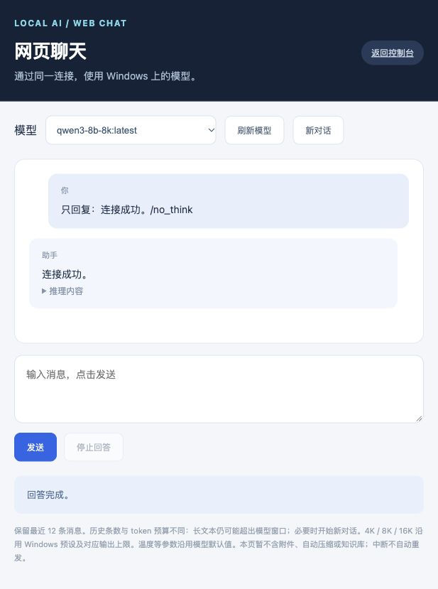

# 整合预览验收

| 项目 | 结果 |
| --- | --- |
| Windows 来源分支 | 已核对：最初上传为 Sub2API 部署脚本，原模型GUI待补传 |
| Mac 核心界面 | 已安装0.2.0-preview.1；实机页面API在线，原网关进程未改变 |
| 模型 API | 本次已在网页完成Windows 8K模型真实流式回答“连接成功”；接口连通不代表全部模型能力 |
| 配置保护/私有文件隔离 | 测试并扫描公开候选，不能当作任意未来文件的保证 |
| 更新查询与校验/回滚 | 隔离测试；首次公开Release附件的实际下载由发布窗口再验 |
| Windows PowerShell | 由该准确commit的Windows CI给出，Mac静态审查不替代原生执行 |
| 多 VPS 双端切换 | 未实测；须Windows注册同名节点，不能假设任意选点互通 |
| Codex GUI切换 | 未实测；原配置未改，独立扩展不占模型首页 |
| 注销/重登、长期后台、手机 | 本版未重新实测 |

截图仅在来源真实且已去除私人节点/密钥时进入公开仓库。Windows截图若为用户旧面板，标“现有Windows界面”，不声称新提交已部署；CI渲染另标环境。

## 本次 Mac 实拍

用户提供了现有Windows模型面板截图（含真实VPS信息），本地保留作为核对证据，不直接公开。原Windows面板源码尚待来源端上传。
